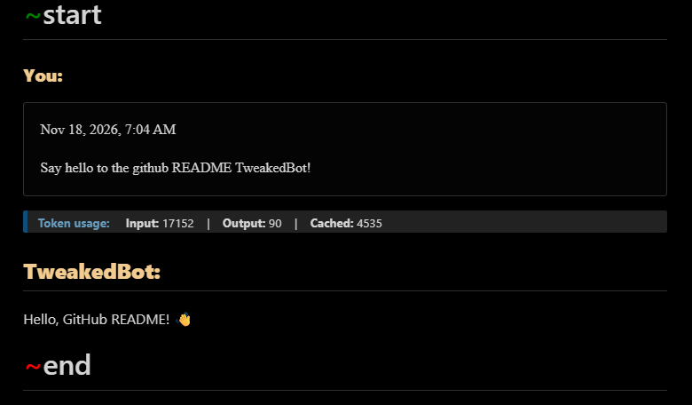

# TweakedBot — AI Codebase Auditor & Developer Assistant

A lightweight, CLI-based AI developer assistant built with **TypeScript, Node.js, and the OpenAI <u><a href="https://developers.openai.com/api/reference/responses/overview/">Responses API</a></u>**.

TweakedBot is a reusable, primarily read-only developer assistant that operates within 
the current project directory. It uses an iterative agent loop to investigate files, execute permitted tools, and answer questions using retrieved repository information.
The model(<em>default is luna</em>) decides which tools to request, while the TypeScript application handles tool 
execution, validation, and conversation logging.

**Codebase analysis is read-only.** 

# Inspiration

TweakedBot started with a simple idea: I wanted an AI assistant that could answer quick questions about a project or homework assignment without constantly copying and pasting code into ChatGPT.
I often found myself explaining project structures, sharing entire scripts, and hoping ChatGPT had enough context to answer accurately. Rather than relying entirely on existing coding assistants, I wanted to build something **simpler** that would hel me understand the code instead of just generating it.

This project is also an opportunity to explore AI agent architecture, tool calling, persistent memory, and practical developer tooling from scratch.
<hr>

# Example Output


<!-- <details>
<summary>View sample agent execution - *NOTE that there is more color than displayed here </summary>

# <span style="color: green;">~</span>start

### <strong><span style="color: #f2cc8f;">You:</span></strong>
```text 
Nov 18, 2026, 7:04 AM

Say hello to the github README TweakedBot!
```

><small><span style="color: #669bbc"><strong>Token usage:</strong></span> &nbsp;&nbsp;&nbsp; **Input:** 17152 &nbsp;&nbsp; | &nbsp;&nbsp; **Output:** 90 &nbsp;&nbsp; | &nbsp;&nbsp; **Cached:** 4535</small>


## <strong><span style="color: #f2cc8f;">TweakedBot:</span></strong>
Hello, GitHub README! 👋

# <span style="color: red;">~</span>end
</details> -->
<hr>

# Features

### AI Agent & Repository Analysis:

- Multi-step tool execution using the OpenAI Responses API.
- Natural-language questions through a global CLI.
- File exploration, reading, and keyword searching.
- Git diff inspection for code reviews and regression analysis. <-- this is not that robust yet
- Source-code explanations and debugging assistance.

### Persistent Conversation History:

- Automatically saves completed conversations to Markdown.
- Loads a bounded (<em>12000 characters of the chat history</em>) excerpt of recent history for subsequent CLI runs.
- Supports follow-up questions using previously saved context.

### Execution Safeguards:
- stays within the folder it was "spawned" at.
- Restricted filesystem tools and argument validation.
- File-size, line-range, and search-result limits.
- Configurable agent step limit (when enabled).
- Token-usage reporting, including cached input tokens.
- READ-ONLY repository investigation.


### How It Works:

1. A user submits a question through the CLI.
2. TweakedBot loads recent conversation history when available.
3. The model receives the question, history context, instructions, and tool definitions.
4. The model requests tools as needed to investigate the repository.
5. TweakedBot executes the tools and returns their results to the model.
6. The process continues until the model produces a final answer or reaches the execution limit.
7. Completed conversations are saved locally for future sessions.
<hr>

# Working Directory & Conversation History:

TweakedBot uses your current working directory as its project context. This directory determines which files the agent can access and where its local conversation history is stored.

<strong>`Important:` Always verify that you're in the correct directory before running TweakedBot!</strong>

Running the agent from the wrong location may generate unwanted <em>tweakedBotChatHistory/</em> folders or give the agent access to a different set of project files than intended.

### Choosing Your Project Context/root

- <strong>To analyze an entire project:</strong> Navigate to the project's root directory.

- <strong>To analyze only source files:</strong> Navigate to the project's src/ directory.

<strong>For example:</strong>
 
    ANALYZE THE ENTIRE PROJECT:
        cd my-project
        tweakedBot "Explain this project"

    ANALYZE THE SRC DIRECTORY:
        cd src
        tweakedBot "Explain these source files"


## Where Is History Saved?

TweakedBot stores its conversation history relative to the directory where the command is executed.

Each project can maintain its own conversation history:

```text
your-project/
├── src/
├── package.json
└── tweakedBotChatHistory/  <--- dont delete this or rename it
    └── recent.md                      <--- dont delete this or rename it
```

Recent exchanges are stored in Markdown/.md and can be supplied to future model requests.

in order to manage context size, only a limited portion of recent history is provided - 12000 characters of the recent.md chat log starting from the most recent chat 


# Installation & Setup

### Prerequisites:

- Node.js and npm
- Git
- <strong>OpenAI API key <--- </strong> <em>I do not provide one</em>
- Internet connection

### 1. Clone & Install

```bash
git clone https://github.com/WillyxWonka/agents_learning.git
cd agents_learning
npm ci
```

### 2. Configure API Key

Create a `.env` file in <u>TweakedBot's</u> installation directory

```env
OPENAI_API_KEY=your_api_key_here
```

**API usage is billed to the account associated with the provided key.**

**`add .env to .gitignore before you forget`**:
### 3. Build & Link CLI

```bash
npm run build
npm link
```

This registers the `tweakedBot` command globally on your local machine so that you can go into bash or code directory and use  the CLI `tweakedBot " ... "`

### 4. Usage

- Navigate to a project directory and type:

```bash
cd path/to/your/project
tweakedBot "Explain this project"
```

- Other examples:

```bash
tweakedBot "Review my current Git changes"
tweakedBot "Find and explain the DFS implementation"
tweakedBot "What tests exist in this project?"
tweakedBot "What were we working on previously?"
```

-  <del> <strong>Optional Step Limit: </strong>

 <del> provide a number after the prompt to override the default execution-step limit of 15


 <del> tweakedBot "Review my current Git changes" 5

<hr>

# Updating TweakedBot

From the TweakedBot installation directory:

```bash
git pull
npm ci
npm run build
```

Existing `npm link` installations normally use the rebuilt files without requiring another link operation. Run `npm link` separately on each new computer.

<hr>

# Project Progress

- [x] Implement filesystem inspection tools.
- [x] Add Git change inspection.
- [x] Implement multi-step agent orchestration.
- [x] Develop a reusable CLI.
- [x] Support natural-language repository questions.
- [x] Track API token usage.
- [x] Implement local Markdown conversation history.
- [x] Automatically save completed exchanges.
- [ ] add option to increase history context from 12000 characters to a user input value
- [ ] Make conversation History more robust and stable
- [ ] improve memory management to allow more context and differnt conversations
- [ ] improve security and guard rails for better scalability
- [ ] Add automatic history summarization and archival.
- [ ] Strengthen filesystem security and error recovery.
- [ ] Improve context retrieval and token efficiency.
- [ ] add better "alt" input arguments like what personality to use and better pasted in parsing.

<hr>

# Notes & Limitations

- I strongly recomend that you add `tweakedBotChatHistory/` to the target project's `.gitignore`.
- Memory is limited to the context of the recent.md file in the tweakedBotChatHistory folder
- The agent currently uses a low end model, but if you fork or clone feel free to swap the model to a more expensive one with your  openAI 
<hr>

# KNOWN BUGS
- currently the agent bugs out if you paste in code that has special characters. i suspect its do to the overly simple input method of adding your question between a pair of quotes (" ").  I am exploring options to fix this such as alt input args and maybe restruction how input is handled to be an object or something less prone to error
- memory might bug out if the recent.md is deleted, renamed, or moved? ive not tested this but i am putting that here in case i forget